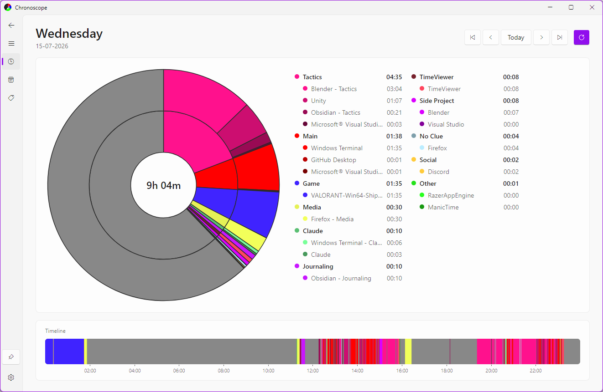
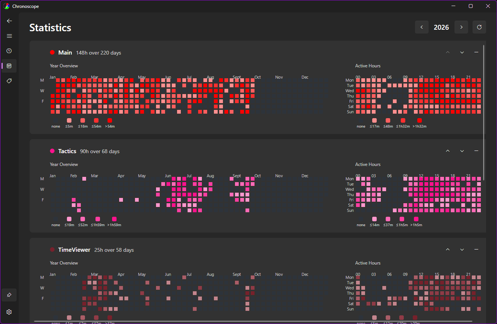
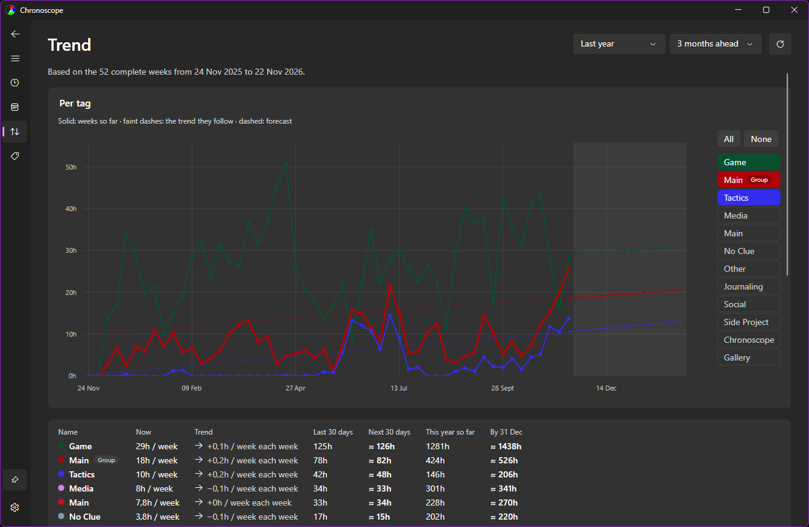
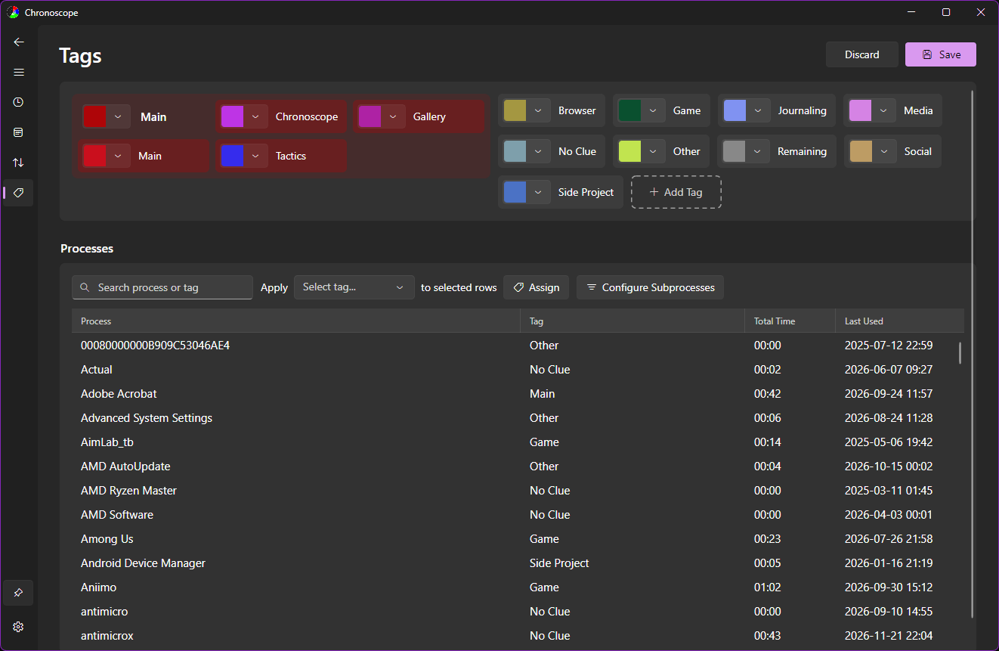
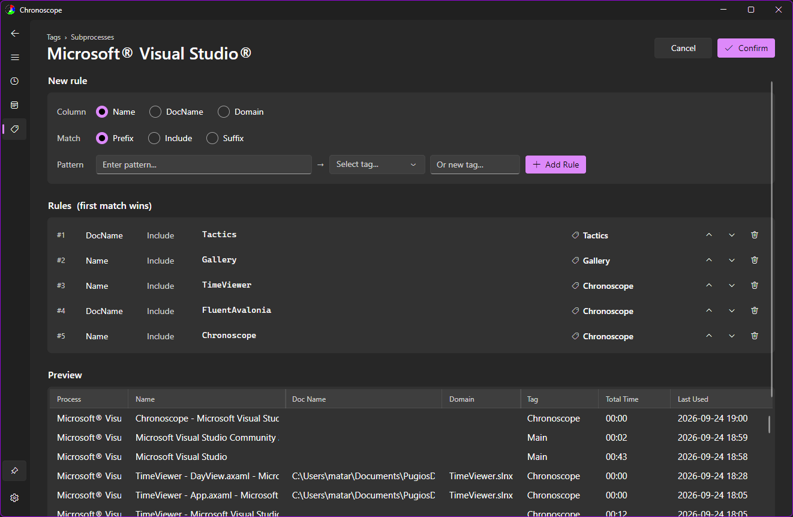
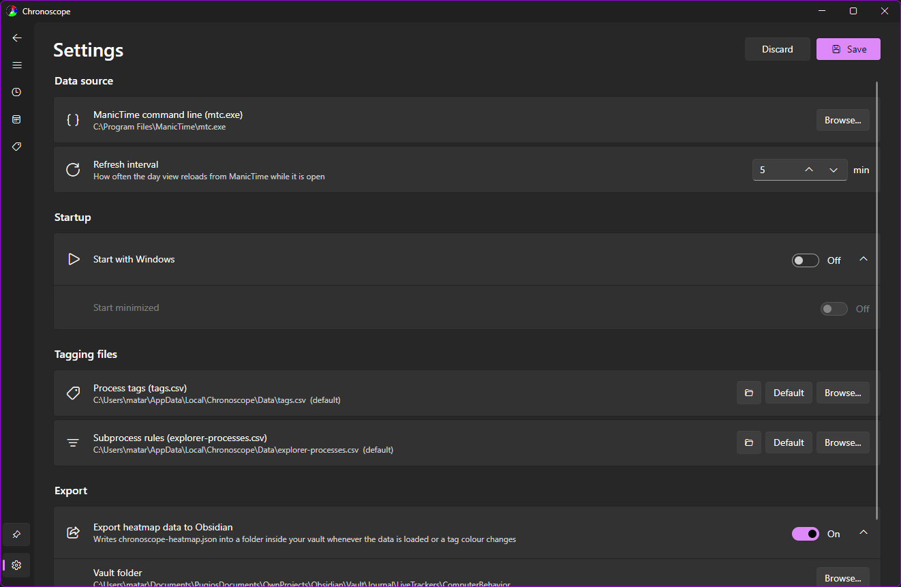

# Chronoscope

**See where your time on the PC actually goes, grouped the way *you* think about it.**

<picture>
  <source media="(prefers-color-scheme: dark)" srcset="./pics/CS1.png">
  
</picture>

I find it fascinating to discover patterns in everything, including my own life. Chronoscope is the tool I built to observe my own behaviour and understand how I really spend each day at the computer.

It sits on top of [ManicTime](https://www.manictime.com/), which quietly records the active window all day. ManicTime's own views are great for tracking how much time to bill a client for a project. But, they are not helpful for quickly answering **"How did I spend my day today?"**

Chronoscope answers exactly that question! Sort every app into your own categories once, and from then on see when you do what - and where it is heading.

> **Chronoscope needs ManicTime.** It reads ManicTime's data through its command line tool
> (`mtc.exe`), so ManicTime has to be installed and tracking for Chronoscope to show anything.

## Getting started

1. Install [ManicTime](https://www.manictime.com/) and let it track for a while.
2. Download `ChronoscopeSetup.exe` from the [latest release](https://github.com/Pugios/Chronoscope/releases/latest) and install it. Windows 10 (1809) or later, x64. 
3. In **Settings**, check the path to `mtc.exe` (the default is `C:\Program Files\ManicTime\mtc.exe`).
4. Open **Tags**, sort the table by Total Time and start tagging your biggest apps. Anything you haven't tagged yet is counted under **No Clue**, so there's no need to do it all at once.
5. Optionally, drag related tags onto each other to form **groups** - "Coding" and "Writing" into "Work", say - and every page shows the groups as well.


## Features

### Your Day

- A nested pie of the day: **groups** inside, then **tags**, then the **apps** behind them. Days without a grouped tag simply show tags and apps
- A legend that reads the same way: each group is one tinted block with its tags and apps beneath it, and stays in one column whenever it fits
- A 24h timeline underneath; hover a block to see the window title, document and domain that were open

### Year Overview


- a GitHub-style heatmap card per tag **and per group** for the whole year, one cell per day
- a weekday $\times$ hour grid showing *when* in the week you spend time on that tag
- Every card has its own legend with the real durations behind each shade
- Reorder the cards, or hide the ones you don't care about

### Trend


Where is my time heading if things carry on like this? The Trend page projects every tag and group forward from your recent weeks.

- One large chart with every tag and group: the weeks so far, the trend they follow, and the forecast. Switch lines on and off with the coloured buttons beside it; groups are drawn a little heavier than the tags they are made of
- A table per tag and group: hours per week **now**, the **trend** (rising, steady or falling), the **last 30 days** next to the projected **next 30 days**, and **this year so far** next to the projected total **by 31 December**
- Next 30 days vs. last 30 days side by side, the week split up by tag, then and projected, and a year-end projection per tag
- Choose how much history the trend is taken from (8 weeks to a year) and how far ahead to look (4 weeks to 6 months)

The model is deliberately simple, so every number can be explained in one sentence: *now* is the average of the last four complete weeks, the *trend* is how much the newer half of the history differs from the older half, and the forecast carries that on, never below zero. Whole weeks only, so a quiet Sunday does not read as a collapse.

### Tags & Groups


- Every tag is a chip on a board, with a full colour picker
- **Drag** a tag onto another to make a group, onto a group to add it, or onto empty space to take it out again. Click a group's name to rename it; it has a colour of its own
- Grouped tags sit together in their group's box, kept close to square
- **Add Tag** right on the board, or from the tag picker of the process table
- Search the process table by process or tag and assign a tag to the selected rows
- Nothing is written until you save, and leaving with unsaved changes asks first

### Create Subprocess Rules


Some apps are used for many things: a browser can be work or YouTube, an editor can be one project or another. For those, you can split the app by **what it had open**:

- Match on the window name, the document name or the domain, by prefix, substring or suffix
- Rules are ordered and the first match wins. Reorder them any time
- A **live preview** shows exactly which activities each rule catches

### Settings


- Point Chronoscope at `mtc.exe` and choose the refresh interval
- Choose to Start with Windows Startup
- Keep `tags.csv` and `explorer-processes.csv` wherever you like, for example in a synced folder shared between machines. The groups (`tag-groups.csv`) always live right beside `tags.csv` and move with it
- All your data stays on your machine: plain CSV and JSON files you can read, edit and back up
- **Obsidian export**: write heatmap data for every tag and group into your vault on every refresh, with the time of the last export (or the reason it failed) shown right here. [More below](#obsidian-heatmap-export)
- **Keep on top** pin, handy for a small window in the corner of your screen

### Obsidian Heatmap Export

Chronoscope can write the Statistics page's heatmap data into an Obsidian vault, so a note can draw the same calendar for any tag or group, next to whatever else you already track there. All it needs is the [Dataview](https://github.com/blacksmithgu/obsidian-dataview) plugin.

Enable it in **Settings**, just pick a folder inside your vault. Chronoscope then rewrites `chronoscope-heatmap.json` there every time it loads data, and whenever a colour or a group changes.
Settings shows when the file was last written, or why the last attempt failed.

### Format

Values are **seconds**, covering every year in your ManicTime data.

- `periods` are the spans a note can draw - the same ones the Statistics page steps through: `pastYear` is its **1 Year** view (the 365 days up to the export, both ends included), and every calendar year with anything tracked is there by its number.
- `tags` and `groups` hold one entry each, in the same shape: the colour, its `ramp` (pale to saturated, as the app draws it), the seconds per `day`, and a `scale` for every period. A group also lists the `tags` it is made of.
- A `scale` is the app's own shading for that period: the `thresholds` between the shades, and the `labels` of the legend, "none" first.

```json
{
  "generatedAt": "2026-11-24T18:02:11+01:00",
  "unit": "seconds",
  "periods": {
    "pastYear": { "from": "2025-11-25", "to": "2026-11-24" },
    "2026":     { "from": "2026-01-01", "to": "2026-12-31" }
  },
  "tags": {
    "Coding": {
      "color": "#1872FF",
      "ramp": ["#99c1ff", "#6ea6ff", "#438cff", "#1771ff"],
      "days": { "2026-03-04": 10830, "2026-03-05": 10800 },
      "scales": {
        "pastYear": { "thresholds": [3000, 6600, 16200], "labels": ["none", "≤50m", "≤1h50m", "≤4h30m", ">4h30m"] },
        "2026":     { "thresholds": [3600, 7200, 18000], "labels": ["none", "≤1h", "≤2h", "≤5h", ">5h"] }
      }
    }
  },
  "groups": {
    "Work": { "color": "#…", "ramp": ["#…"], "days": { }, "scales": { }, "tags": ["Coding", "Writing"] }
  }
}
```
Dark cells mean *a heavy day for that tag or group*, not a fixed number of hours, so the legend below the grid is worth drawing: the scale differs between tags!

A shade is picked as the app picks it: `0` for a day with nothing tracked, otherwise the first threshold the day fits under (counting from 1), otherwise `4`. `ramp[shade - 1]` is its colour and `labels[shade]` its legend text.

#### The note

Paste into any note and set `name` and `period`. A tag is `data.tags[name]`, a group `data.groups[name]`; a period is `"pastYear"` or a year such as `"2025"`. It draws its own grid - Monday on top, one column per week, months named the way the app names them - so it agrees with the Statistics page cell for cell.

The span comes from the file, not the note's own clock: it always matches the days and shades exported with it.

````markdown
```dataviewjs
const path   = "Chronoscope/chronoscope-heatmap.json"
const name   = "Coding"
const period = "pastYear"           // the rolling year, as on the Statistics page - or a year: "2025"

const data = JSON.parse(await dv.io.load(path))
const t    = data.tags[name]        // a group instead: data.groups[name]
if (!t) { dv.paragraph(`No "${name}" in ${path}.`); return }

const span  = data.periods[period]
const scale = t.scales[period]
if (!span || !scale) { dv.paragraph(`No period "${period}" in ${path}.`); return }
const th    = scale.thresholds

// Dates as UTC midnights, so a day is always exactly 24h and DST cannot shift a cell.
const DAY     = 864e5
const parse   = (s) => { const [y, m, d] = s.split("-").map(Number); return new Date(Date.UTC(y, m - 1, d)) }
const iso     = (d) => d.toISOString().slice(0, 10)
const addDays = (d, n) => new Date(d.getTime() + n * DAY)
const weekday = (d) => (d.getUTCDay() + 6) % 7   // Monday = 0, as in the app

const from      = parse(span.from)
const to        = parse(span.to)
const firstCell = addDays(from, -weekday(from))  // the Monday of the first week
const weekCount = Math.floor((to - firstCell) / DAY / 7) + 1

// The app's rule: 0 for nothing tracked, else the first step the day fits under, else the top one.
const bucket = (seconds) => {
    if (seconds <= 0) return 0
    for (let i = 0; i < th.length; i++) if (seconds <= th[i]) return i + 1
    return 4
}

// The span on screen - and, for a group, the tags it is made of
const fmtDay = (d) => d.toLocaleDateString(undefined,
    { day: "numeric", month: "short", year: "numeric", timeZone: "UTC" })
const members = t.tags ? `  ·  ${t.tags.join(", ")}` : ""
this.container.createEl("div", { text: `${fmtDay(from)} – ${fmtDay(to)}${members}`,
    attr: { style: "font-size:11px; opacity:0.7; margin-bottom:6px;" } })

// Column 1 holds the weekday labels, row 1 the month labels; the weeks fill the rest.
const grid = this.container.createEl("div", { attr: { style: `
    display:grid; grid-template-columns:1.4em repeat(${weekCount}, minmax(0, 1fr));
    grid-template-rows:auto repeat(7, auto); gap:3px; font-size:10px;` }})

// Months, the app's rule: a column is named after the month its Sunday falls in, a column whose
// Sunday is past the span gets no label, and a first month cut to a column or two is dropped so
// its label does not print over the next one.
const months = []
let lastMonth = -1
for (let w = 0; w < weekCount; w++) {
    const sunday = addDays(firstCell, w * 7 + 6)
    if (sunday > to || sunday.getUTCMonth() === lastMonth) continue
    months.push(w)
    lastMonth = sunday.getUTCMonth()
}
if (months.length > 1 && months[1] - months[0] < 3) months.shift()

months.forEach(w => grid.createEl("div", {
    text: addDays(firstCell, w * 7 + 6).toLocaleDateString(undefined, { month: "short", timeZone: "UTC" }),
    attr: { style: `grid-row:1; grid-column:${w + 2}; white-space:nowrap; opacity:0.7;` }
}))

;[["M", 0], ["W", 2], ["F", 4]].forEach(([text, row]) => grid.createEl("div", {
    text, attr: { style: `grid-row:${row + 2}; grid-column:1; align-self:center; opacity:0.7;` }
}))

// One cell per day of the span; the corners of the first and last week stay blank.
const now   = new Date()
const today = `${now.getFullYear()}-${String(now.getMonth() + 1).padStart(2, "0")}-${String(now.getDate()).padStart(2, "0")}`

for (let d = from; d <= to; d = addDays(d, 1)) {
    const offset = Math.round((d - firstCell) / DAY)
    const date   = iso(d)
    const b      = bucket(t.days[date] ?? 0)
    grid.createEl("div", { attr: {
        "data-date": date,
        style: `grid-row:${(offset % 7) + 2}; grid-column:${Math.floor(offset / 7) + 2};
            aspect-ratio:1; border-radius:3px; position:relative;
            background:${b === 0 ? "var(--background-modifier-border)" : t.ramp[b - 1]};
            ${date === today ? "outline:1px solid var(--text-normal); outline-offset:-1px;" : ""}`
    }})
}

// Legend: one swatch per step, labelled as the app labels it.
const legend = this.container.createEl("div", { attr: {
    style: "display:flex; align-items:flex-end; gap:6px; margin-top:10px; flex-wrap:wrap;"
}})

scale.labels.forEach((label, i) => {
    const cell = legend.createEl("div", { attr: {
        style: "display:flex; flex-direction:column; align-items:center; gap:3px;"
    }})
    cell.createEl("div", { attr: {
        style: `width:22px; height:22px; border-radius:4px; background:${
            i === 0 ? "var(--background-modifier-border)" : t.ramp[i - 1]};`
    }})
    cell.createEl("span", { text: label, attr: { style: "font-size:10px; opacity:0.7;" } })
})

// Hover: the exact time behind a cell. Built on first hover rather than up front.
const fmtLong = (s) => {
    // Round to whole minutes FIRST, or 59.9 minutes renders as "60 min" instead of "1 h".
    const mins = Math.round(s / 60)
    const h = Math.floor(mins / 60)
    const m = mins % 60
    if (h === 0) return `${Math.max(m, 1)} min`
    return m === 0 ? `${h} h` : `${h} h ${m} min`
}

const buildTooltip = (box, date) => {
    const tip = box.createEl("div", { attr: { style: `
        position:absolute; bottom:calc(100% + 6px); left:50%; transform:translateX(-50%);
        z-index:20; width:max-content; pointer-events:none; white-space:nowrap;
        padding:6px 8px; border-radius:6px; font-size:11px; line-height:1.5; text-align:left;
        background:var(--background-secondary); color:var(--text-normal);
        border:1px solid var(--background-modifier-border);
        box-shadow:0 2px 8px rgba(0,0,0,0.25);` }})

    tip.createEl("div", { text: date, attr: { style: "font-weight:600; margin-bottom:3px;" } })

    const row = tip.createEl("div", { attr: {
        style: "display:flex; gap:12px; justify-content:space-between;"
    }})
    row.createEl("span", { text: name, attr: { style: "opacity:0.75;" } })
    row.createEl("span", { text: t.days[date] ? fmtLong(t.days[date]) : "nothing tracked" })

    return tip
}

// Centred over its box, a tooltip near either edge would reach past the note and be clipped by
// the editor's scroller. So once shown, it measures itself against this block and slides back
// inside it - the arrowless box can sit off-centre without pointing at the wrong day.
const keepInside = (tip) => {
    tip.style.transform = "translateX(-50%)"
    tip.style.top       = ""
    tip.style.bottom    = "calc(100% + 6px)"
    const bounds = this.container.getBoundingClientRect()

    // The top rows have no room above them inside the block: open below the box instead
    if (tip.getBoundingClientRect().top < bounds.top) {
        tip.style.bottom = ""
        tip.style.top    = "calc(100% + 6px)"
    }

    const rect   = tip.getBoundingClientRect()
    const shift  = rect.right > bounds.right ? bounds.right - rect.right
                 : rect.left  < bounds.left  ? bounds.left  - rect.left
                 : 0
    tip.style.transform = `translateX(calc(-50% + ${shift}px))`
}

grid.querySelectorAll("[data-date]").forEach(box => {
    box.addEventListener("mouseenter", () => {
        box._tip = box._tip ?? buildTooltip(box, box.dataset.date)
        box._tip.style.display = "block"
        keepInside(box._tip)
    })
    box.addEventListener("mouseleave", () => {
        if (box._tip) box._tip.style.display = "none"
    })
})
```
````

To list what is available instead of hardcoding a name: `Object.keys(data.tags)`, `Object.keys(data.groups)` and `Object.keys(data.periods)`.
